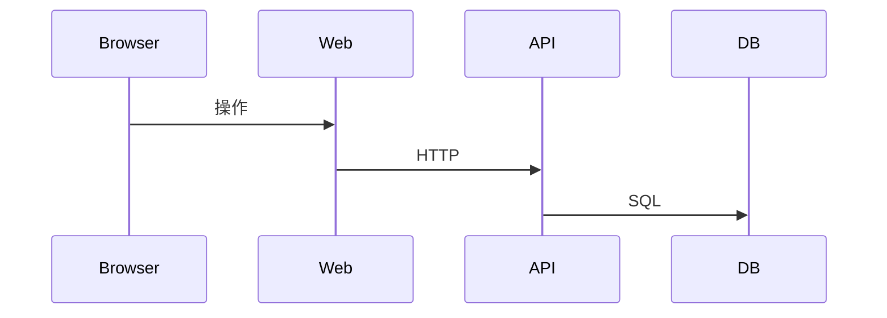

# 設計テンプレート

## 方針の比較 (判断が分かれる点ごと)
| 案 | 概要 | 長所 | 短所 |
|---|---|---|---|
| A | | | |
| B | | | |

推奨: 〇案。理由:

## 契約 (この順に確定させる)
1. **共有スキーマ** (`packages/shared`): 追加・変更する zod スキーマ
2. **DB** (`packages/db`): テーブル・列・インデックス・マイグレーションの有無
3. **API** (`apps/api`): メソッド / パス / 入力 / 成功応答 / エラー応答 (400・404 など)
4. **Web** (`apps/web`): 画面・コンポーネント (サーバー / クライアントの区別)・状態

## 図 (必要なら)

## 本番への影響
- 環境変数 / マイグレーション / CORS / 後方互換性

## タスク分割
| ID | 内容 | 担当ファイル | 依存 | 並列可否 |
|---|---|---|---|---|
| T1 | 共有スキーマ | packages/shared/src/todo.ts | - | 先行 |
| T2 | API | apps/api/src/** | T1 | T3 と並列 |
| T3 | Web | apps/web/src/** | T1 | T2 と並列 |
| T4 | テスト | **/*.test.ts | T1 | T2, T3 と並列 |
